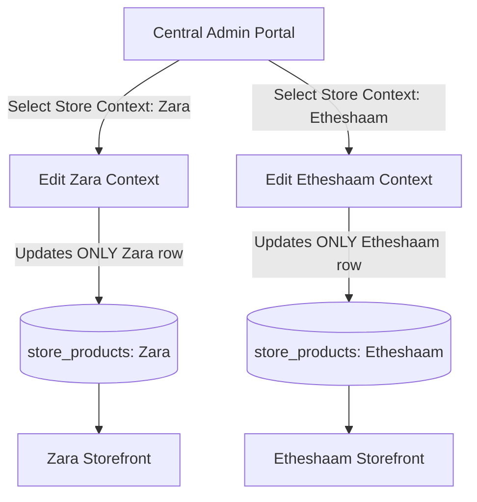

# 🌐 ULTIMATE ENTERPRISE MULTI-STORE ARCHITECTURE
## 10 to 100+ Stores Single Admin Panel (Zero Data-Mixup & Strict Store Isolation)

---

## 📌 Complete Table of Contents
1. [Architecture & Zero-Mixup Rule](#1-architecture--the-zero-mixup-rule)
2. [Project Folder Layout (Clean Separation)](#2-project-folder-layout)
3. [Kyu Admin Panel Ko Alag Standalone Project Rakhna Zaroori Hai?](#3-standalone-admin-panel-necessity)
4. [Enterprise Database Schema (Foreign Keys + Cascade + Unique Constraints)](#4-enterprise-database-schema)
5. [Strict Store Data Isolation (Zara vs Etheshaam Separation)](#5-strict-store-data-isolation-how-it-works)
6. [Standalone Admin Panel Code (Store Switcher + Isolated Edits)](#6-standalone-admin-panel-code)
7. [Storefront Frontend Integration (Zara, Etheshaam, etc.)](#7-storefront-frontend-integration)
8. [Orders & Checkout Isolation (Store-Specific Invoices)](#8-orders--checkout-isolation)
9. [High-Traffic & 100 Stores Performance Safeguards](#9-high-traffic--performance-safeguards)
10. [🛡️ ENTERPRISE SECURITY, CRASH PREVENTION & DISASTER RECOVERY](#10-enterprise-security-crash-prevention--disaster-recovery)
    * [A. Database Crash Prevention (Pool Exhaustion, Runaway Locks)](#a-database-crash-prevention)
    * [B. Server Crash & High-Traffic Spikes (100 Sites Online)](#b-server-crash--high-traffic-spikes)
    * [C. Data Corruption & Disaster Recovery (Soft Deletes, PITR, Audit Logs)](#c-data-corruption--disaster-recovery)
11. [Production Deployment & Launch Checklist](#11-production-deployment-checklist)

---

## 1. Architecture & The Zero-Mixup Rule

### ⚠️ Sab se Bara Khadsha (The Risk):
> *"Agar main Zara Store mein kisi product ka price ya stock change karun, to ghalti se Etheshaam Store ya kisi teesre store par change na ho jaye!"*

### 🛡️ Senior Architect's Zero-Mixup Guarantee:
Is system mein **Master Product Catalog** aur **Store Inventory** do alag-alag layers par rehte hain.
* **Master Product:** Product ki bunyadi information (Jaise Title, Images, Description).
* **Store Product Instance (`store_products`):** Har store ka apna personal record hota hai jisme:
  * **Store A (Zara):** Price = $35.00 | Stock = 10 | Status = Active
  * **Store B (Etheshaam):** Price = $55.00 | Stock = 40 | Status = Active
  * **Store C (Shoes Hub):** Price = $49.00 | Stock = 0 | Status = Hidden

👉 **Jab aap Zara mein price $30 karte hain:**
SQL query sirf `store_products` mein `store_id = 'zara-site'` ko update karti hai. Etheshaam ya doosre stores ki row ko **touch bhi nahi kiya jata**.



---

## 2. Project Folder Layout

Senior developers kabhi bhi admin panel ko kisi ek client website ke andar nahi dalte. Admin panel hamesha **alag standalone project** hota hai:

```plaintext
d:\Downloads\
├── 🛡️ central-admin-portal/         <--- STANDALONE ADMIN PANEL (Protected, Private)
│   ├── .env                         <--- Supabase Keys
│   ├── src/
│   │   ├── components/
│   │   │   ├── StoreSwitcher.jsx    <--- Zara, Etheshaam, etc. switch karne ke liye
│   │   │   ├── ProductForm.jsx      <--- Master Product Creator
│   │   │   └── StoreInventory.jsx   <--- Store-specific price/stock editor
│   │   └── App.jsx
│   └── package.json
│
├── 🛍️ store-01-zara/               <--- Zara Website (Frontend) -> VITE_STORE_ID="zara-site"
├── 🛍️ store-02-etheshaam/          <--- Etheshaam Website (Frontend) -> VITE_STORE_ID="etheshaam-site"
├── 🛍️ store-03-shoes/              <--- Shoes Website (Frontend) -> VITE_STORE_ID="shoes-site"
└── 🛍️ store-04-to-100/            <--- Baqi 100 Stores...
```

---

## 3. Standalone Admin Panel Necessity

| Feature | Website ke andar `/admin` | Standalone Admin Folder ✅ |
| :--- | :--- | :--- |
| **Data Mixup Risk** | ❌ Zyada risk hota hai kyunki routing aur local state share ho rahi hoti hai. | ✅ Zero risk. Har store ka context alag state mein load hota hai. |
| **Security** | ❌ Admin keys aur logic Zara ke public code bundle mein chali jati hain. | ✅ Admin panel alag private domain (`admin.mybrand.com`) par chalta hai. |
| **Single Point of Failure** | ❌ Agar Zara site down hui to baki 99 stores ka admin bhi block. | ✅ Har store independent hai. Zara band bhi ho to baqi 99 stores chalte rahenge. |
| **Client Code Handover** | ❌ Agar Zara ka code client ko dena para to wo Etheshaam ka data dekh lega. | ✅ Client ko sirf uski website ka frontend milta hai, admin safe rehta hai. |

---

## 4. Enterprise Database Schema

Yeh SQL script Supabase Dashboard -> **SQL Editor** mein run karein. Isme **Referential Integrity, Foreign Keys, Soft Deletes, aur Cascading** shamil hai taake database kabhi corrupt na ho:

```sql
-- ========================================================
-- 1. STORES REGISTRY TABLE (Up to 100 Stores)
-- ========================================================
create table if not exists stores (
  id text primary key,                     -- e.g. 'zara-site', 'etheshaam-site'
  name text not null,                      -- Display Name: "Zara Fashion", "Etheshaam Luxury"
  domain text,                             -- e.g. "https://zarafashion.com"
  currency text default 'USD',
  is_active boolean default true,
  deleted_at timestamptz default null,     -- Soft delete protection
  created_at timestamptz default now() not null
);

-- Insert initial stores
insert into stores (id, name, domain, currency) values
('zara-site', 'Zara Fashion', 'https://zara-store.com', 'USD'),
('etheshaam-site', 'Etheshaam Luxury', 'https://etheshaam-store.com', 'USD'),
('shoes-site', 'Sneakers Hub', 'https://shoes-store.com', 'USD')
on conflict (id) do nothing;

-- ========================================================
-- 2. MASTER PRODUCTS TABLE (Central Catalog)
-- ========================================================
create table if not exists products (
  id uuid default gen_random_uuid() primary key,
  sku text unique not null,                -- Barcode / Unique Item Code
  title text not null,
  description text,
  base_price numeric(10,2) not null check (base_price >= 0),
  image text not null,
  category text,
  is_active boolean default true,
  deleted_at timestamptz default null,     -- Soft delete protection (Never accidental delete)
  created_at timestamptz default now() not null,
  updated_at timestamptz default now() not null
);

-- ========================================================
-- 3. STORE_PRODUCTS JUNCTION TABLE (STRICT STORE ISOLATION)
-- ========================================================
create table if not exists store_products (
  id uuid default gen_random_uuid() primary key,
  store_id text references stores(id) on delete cascade not null,
  product_id uuid references products(id) on delete cascade not null,
  
  -- STORE SPECIFIC OVERRIDES (Zara ka change Etheshaam ko nahi chhu sakta)
  custom_price numeric(10,2) check (custom_price is null or custom_price >= 0),
  custom_title text,
  stock integer default 50 check (stock >= 0), -- Prevents negative stock
  is_visible boolean default true,
  deleted_at timestamptz default null,
  
  created_at timestamptz default now() not null,
  updated_at timestamptz default now() not null,
  
  -- PREVENTS DUPLICATE BUG: Ek store mein ek product sirf 1 hi baar map ho sakta hai
  unique(store_id, product_id)
);

-- High speed indexes for 100 websites
create index if not exists idx_sp_store on store_products(store_id);
create index if not exists idx_sp_product on store_products(product_id);
create index if not exists idx_sp_visible on store_products(store_id, is_visible) where deleted_at is null;
create index if not exists idx_products_sku on products(sku) where deleted_at is null;

-- ========================================================
-- 4. ROW LEVEL SECURITY (RLS)
-- ========================================================
alter table stores enable row level security;
alter table products enable row level security;
alter table store_products enable row level security;

-- Public stores can only read their active, non-deleted items
create policy "Public read active stores" on stores for select using (is_active = true and deleted_at is null);
create policy "Public read active products" on products for select using (is_active = true and deleted_at is null);
create policy "Public read store products" on store_products for select using (is_visible = true and deleted_at is null);

-- Admin has full access to insert, update, delete
create policy "Admin all stores" on stores for all to authenticated using (true) with check (true);
create policy "Admin all products" on products for all to authenticated using (true) with check (true);
create policy "Admin all store_products" on store_products for all to authenticated using (true) with check (true);
```

---

## 5. Strict Store Data Isolation (How it Works)

Database level par **Zara** aur **Etheshaam** ki rows bilkul alag rehti hain:

| id | store_id | product_id | custom_price | stock | is_visible |
| :--- | :--- | :--- | :--- | :--- | :--- |
| **Row 101** | `zara-site` | `hoodie-001` | **$35.00** *(Zara ki price)* | **12** *(Zara stock)* | `true` |
| **Row 102** | `etheshaam-site` | `hoodie-001` | **$55.00** *(Etheshaam price)*| **40** *(Eth stock)* | `true` |
| **Row 103** | `shoes-site` | `hoodie-001` | **$49.00** *(Shoes price)* | **0** *(Out of stock)*| `false` *(Hidden)* |

### Update Action in Admin Panel:
Jab aap Zara store ka price ya stock update karte hain:
```sql
-- EXACT SAFE UPDATE QUERY:
UPDATE store_products
SET custom_price = 30.00, stock = 10, updated_at = now()
WHERE store_id = 'zara-site' AND product_id = 'hoodie-001';
```
> **Notice:** Is query mein `WHERE store_id = 'zara-site'` laga hai. Etheshaam (`etheshaam-site`) ki row touch bhi nahi ho sakti!

---

## 6. Standalone Admin Panel Code

Yeh complete React Admin Dashboard hai jisme **Store Context Switcher** laga hai taake aap jis store ko select karein, sirf usi ka data screen par aaye aur usi ka data edit ho.

### Setup Standalone Admin
```bash
cd d:\Downloads
npm create vite@latest central-admin-portal -- --template react
cd central-admin-portal
npm install @supabase/supabase-js lucide-react
```

### Complete Admin App (`src/App.jsx`)
```jsx
import React, { useState, useEffect } from 'react';
import { createClient } from '@supabase/supabase-js';

const supabase = createClient(
  import.meta.env.VITE_SUPABASE_URL,
  import.meta.env.VITE_SUPABASE_ANON_KEY
);

export default function CentralAdmin() {
  const [stores, setStores] = useState([]);
  const [activeStoreId, setActiveStoreId] = useState('zara-site');
  const [storeInventory, setStoreInventory] = useState([]);
  const [loading, setLoading] = useState(false);

  // New Master Product Form
  const [title, setTitle] = useState('');
  const [sku, setSku] = useState('');
  const [basePrice, setBasePrice] = useState('');
  const [category, setCategory] = useState('');
  const [image, setImage] = useState('');
  const [assignStores, setAssignStores] = useState(['zara-site', 'etheshaam-site']);

  useEffect(() => {
    loadStores();
  }, []);

  useEffect(() => {
    if (activeStoreId) {
      loadStoreInventory(activeStoreId);
    }
  }, [activeStoreId]);

  async function loadStores() {
    const { data } = await supabase.from('stores').select('*').is('deleted_at', null).order('name');
    if (data && data.length > 0) {
      setStores(data);
      if (!activeStoreId) setActiveStoreId(data[0].id);
    }
  }

  // Load ONLY the selected store's inventory (Strict Isolation)
  async function loadStoreInventory(storeId) {
    setLoading(true);
    const { data } = await supabase
      .from('store_products')
      .select(`
        id,
        custom_price,
        custom_title,
        stock,
        is_visible,
        product:products (
          id,
          sku,
          title,
          base_price,
          image,
          category
        )
      `)
      .eq('store_id', storeId)
      .is('deleted_at', null);

    if (data) setStoreInventory(data);
    setLoading(false);
  }

  // Update Specific Store Product (Does NOT affect other stores!)
  async function handleUpdateStoreProduct(rowId, newPrice, newStock, isVisible) {
    const { error } = await supabase
      .from('store_products')
      .update({
        custom_price: parseFloat(newPrice),
        stock: parseInt(newStock),
        is_visible: isVisible,
        updated_at: new Date().toISOString()
      })
      .eq('id', rowId)
      .eq('store_id', activeStoreId); // 👈 Safeguard: Only update this store!

    if (error) {
      alert('Error updating: ' + error.message);
    } else {
      alert(`Updated for ${activeStoreId} only! (Baqi stores safe hain)`);
      loadStoreInventory(activeStoreId);
    }
  }

  // Soft Delete from Store (Recovers with 1 click)
  async function handleSoftDelete(rowId) {
    if (!window.confirm('Yeh product is store se hide/remove kar dein?')) return;
    await supabase.from('store_products').update({ deleted_at: new Date().toISOString() }).eq('id', rowId);
    loadStoreInventory(activeStoreId);
  }

  // Add New Product to Master & Assign to selected stores
  async function handleCreateProduct(e) {
    e.preventDefault();
    if (assignStores.length === 0) {
      alert('Kam az kam ek store select karein!');
      return;
    }

    setLoading(true);
    // 1. Create in Master Catalog
    const { data: product, error: pError } = await supabase
      .from('products')
      .insert([{
        title,
        sku: sku || `SKU-${Date.now()}`,
        base_price: parseFloat(basePrice),
        category,
        image
      }])
      .select()
      .single();

    if (pError) {
      alert('Error: ' + pError.message);
      setLoading(false);
      return;
    }

    // 2. Map to selected stores with their own rows
    const mappings = assignStores.map(sId => ({
      store_id: sId,
      product_id: product.id,
      custom_price: parseFloat(basePrice),
      stock: 50,
      is_visible: true
    }));

    await supabase.from('store_products').insert(mappings);

    alert(`Product created and mapped independently to ${assignStores.length} stores!`);
    setTitle('');
    setSku('');
    setBasePrice('');
    setCategory('');
    setImage('');
    loadStoreInventory(activeStoreId);
    setLoading(false);
  }

  const currentStoreObj = stores.find(s => s.id === activeStoreId);

  return (
    <div style={{ maxWidth: '1280px', margin: '0 auto', padding: '24px', fontFamily: 'system-ui, sans-serif' }}>
      {/* Top Header */}
      <header style={{ display: 'flex', justifyContent: 'space-between', alignItems: 'center', borderBottom: '2px solid #e5e7eb', paddingBottom: '16px', marginBottom: '24px' }}>
        <div>
          <h1 style={{ margin: 0, fontSize: '24px' }}>🛡️ Central Admin Portal (Multi-Store)</h1>
          <p style={{ margin: '4px 0 0 0', color: '#6b7280' }}>Strict Store Isolation Enabled: Zero Data-Mixup & Crash Protected</p>
        </div>

        {/* ACTIVE STORE SELECTOR SWITCHER */}
        <div style={{ background: '#f3f4f6', padding: '10px 16px', borderRadius: '8px', border: '1px solid #d1d5db' }}>
          <label style={{ marginRight: '10px', fontWeight: 'bold' }}>Active Store Context:</label>
          <select 
            value={activeStoreId} 
            onChange={e => setActiveStoreId(e.target.value)}
            style={{ padding: '8px 12px', borderRadius: '6px', fontWeight: 'bold', fontSize: '14px' }}
          >
            {stores.map(s => (
              <option key={s.id} value={s.id}>{s.name} ({s.id})</option>
            ))}
          </select>
        </div>
      </header>

      {/* Product Creator Form */}
      <section style={{ background: '#f9fafb', padding: '20px', borderRadius: '8px', border: '1px solid #e5e7eb', marginBottom: '32px' }}>
        <h3 style={{ marginTop: 0 }}>➕ Add New Master Product</h3>
        <form onSubmit={handleCreateProduct} style={{ display: 'grid', gap: '12px' }}>
          <div style={{ display: 'grid', gridTemplateColumns: '2fr 1fr 1fr', gap: '12px' }}>
            <input placeholder="Title *" value={title} onChange={e => setTitle(e.target.value)} required style={{ padding: '8px' }} />
            <input placeholder="SKU (e.g. ZARA-01)" value={sku} onChange={e => setSku(e.target.value)} style={{ padding: '8px' }} />
            <input placeholder="Base Price ($) *" type="number" step="0.01" value={basePrice} onChange={e => setBasePrice(e.target.value)} required style={{ padding: '8px' }} />
          </div>
          <div style={{ display: 'grid', gridTemplateColumns: '1fr 2fr', gap: '12px' }}>
            <input placeholder="Category" value={category} onChange={e => setCategory(e.target.value)} style={{ padding: '8px' }} />
            <input placeholder="Image URL *" value={image} onChange={e => setImage(e.target.value)} required style={{ padding: '8px' }} />
          </div>

          <div>
            <strong>Assign this product to initial stores:</strong>
            <div style={{ display: 'flex', gap: '16px', marginTop: '8px' }}>
              {stores.map(s => (
                <label key={s.id} style={{ display: 'flex', alignItems: 'center', gap: '6px', cursor: 'pointer' }}>
                  <input 
                    type="checkbox" 
                    checked={assignStores.includes(s.id)}
                    onChange={() => {
                      setAssignStores(prev => prev.includes(s.id) ? prev.filter(x => x !== s.id) : [...prev, s.id]);
                    }}
                  />
                  <span>{s.name}</span>
                </label>
              ))}
            </div>
          </div>

          <button type="submit" disabled={loading} style={{ padding: '10px', background: '#111827', color: '#fff', border: 'none', borderRadius: '6px', cursor: 'pointer', fontWeight: 'bold' }}>
            {loading ? 'Creating...' : 'Save Product & Link Stores 🚀'}
          </button>
        </form>
      </section>

      {/* ISOLATED STORE INVENTORY TABLE */}
      <section>
        <div style={{ display: 'flex', justifyContent: 'space-between', alignItems: 'center', marginBottom: '16px' }}>
          <div>
            <h2 style={{ margin: 0 }}>📦 {currentStoreObj?.name} Inventory ({storeInventory.length} Items)</h2>
            <small style={{ color: '#059669', fontWeight: 'bold' }}>
              ℹ️ Yahan jo bhi change karenge sirf {currentStoreObj?.name} par effect hoga!
            </small>
          </div>
          <button onClick={() => loadStoreInventory(activeStoreId)} style={{ padding: '6px 12px' }}>Refresh</button>
        </div>

        <table style={{ width: '100%', borderCollapse: 'collapse', textAlign: 'left' }}>
          <thead>
            <tr style={{ background: '#f3f4f6', borderBottom: '2px solid #ddd' }}>
              <th style={{ padding: '10px' }}>Item</th>
              <th style={{ padding: '10px' }}>Base Price</th>
              <th style={{ padding: '10px' }}>This Store Price ($)</th>
              <th style={{ padding: '10px' }}>This Store Stock</th>
              <th style={{ padding: '10px' }}>Status</th>
              <th style={{ padding: '10px' }}>Save Action</th>
              <th style={{ padding: '10px' }}>Remove</th>
            </tr>
          </thead>
          <tbody>
            {storeInventory.map(item => (
              <InventoryRow 
                key={item.id} 
                item={item} 
                onSave={handleUpdateStoreProduct} 
                onDelete={handleSoftDelete}
              />
            ))}
          </tbody>
        </table>
      </section>
    </div>
  );
}

// Row component with isolated local state
function InventoryRow({ item, onSave, onDelete }) {
  const [price, setPrice] = useState(item.custom_price !== null ? item.custom_price : item.product.base_price);
  const [stock, setStock] = useState(item.stock);
  const [visible, setVisible] = useState(item.is_visible);

  return (
    <tr style={{ borderBottom: '1px solid #eee' }}>
      <td style={{ padding: '10px', display: 'flex', alignItems: 'center', gap: '10px' }}>
        
        <div>
          <div style={{ fontWeight: 600 }}>{item.product.title}</div>
          <small style={{ color: '#6b7280' }}>{item.product.sku}</small>
        </div>
      </td>
      <td style={{ padding: '10px', color: '#6b7280' }}>${item.product.base_price}</td>
      <td style={{ padding: '10px' }}>
        <input 
          type="number" 
          step="0.01" 
          value={price} 
          onChange={e => setPrice(e.target.value)} 
          style={{ width: '90px', padding: '6px' }}
        />
      </td>
      <td style={{ padding: '10px' }}>
        <input 
          type="number" 
          value={stock} 
          onChange={e => setStock(e.target.value)} 
          style={{ width: '70px', padding: '6px' }}
        />
      </td>
      <td style={{ padding: '10px' }}>
        <label style={{ display: 'flex', alignItems: 'center', gap: '6px', cursor: 'pointer' }}>
          <input 
            type="checkbox" 
            checked={visible} 
            onChange={e => setVisible(e.target.checked)} 
          />
          <span style={{ fontSize: '13px' }}>{visible ? 'Live' : 'Hidden'}</span>
        </label>
      </td>
      <td style={{ padding: '10px' }}>
        <button 
          onClick={() => onSave(item.id, price, stock, visible)}
          style={{ padding: '6px 12px', background: '#2563eb', color: '#fff', border: 'none', borderRadius: '4px', cursor: 'pointer' }}
        >
          Save Only for this Store
        </button>
      </td>
      <td style={{ padding: '10px' }}>
        <button 
          onClick={() => onDelete(item.id)}
          style={{ color: '#dc2626', background: 'none', border: 'none', cursor: 'pointer' }}
        >
          Remove
        </button>
      </td>
    </tr>
  );
}
```

---

## 7. Storefront Frontend Integration

Har website sirf apna specific data load karegi.

### Step 1: Zara Website `.env`
```env
VITE_SUPABASE_URL=https://your-project.supabase.co
VITE_SUPABASE_ANON_KEY=your-anon-key
VITE_STORE_ID=zara-site
```

### Step 2: Etheshaam Website `.env`
```env
VITE_SUPABASE_URL=https://your-project.supabase.co
VITE_SUPABASE_ANON_KEY=your-anon-key
VITE_STORE_ID=etheshaam-site
```

### Step 3: Safe Fetching Logic (`src/services/storeService.js`)
```javascript
import { createClient } from '@supabase/supabase-js';

const supabase = createClient(
  import.meta.env.VITE_SUPABASE_URL,
  import.meta.env.VITE_SUPABASE_ANON_KEY
);

export async function getStoreProducts() {
  const storeId = import.meta.env.VITE_STORE_ID;

  // Strict query: ONLY loads products mapped to THIS store (Soft delete safe)
  const { data, error } = await supabase
    .from('store_products')
    .select(`
      id,
      custom_price,
      stock,
      product:products (
        id,
        sku,
        title,
        description,
        base_price,
        image,
        category
      )
    `)
    .eq('store_id', storeId)
    .eq('is_visible', true)
    .is('deleted_at', null)
    .gt('stock', 0); // Out of stock hide

  if (error) {
    console.error('Error fetching for store:', storeId, error);
    return [];
  }

  // Format clean list for UI
  return data.map(item => ({
    id: item.product.id,
    sku: item.product.sku,
    title: item.product.title,
    // Store price if set, otherwise base price
    price: item.custom_price !== null ? item.custom_price : item.product.base_price,
    image: item.product.image,
    category: item.product.category,
    stock: item.stock
  }));
}
```

---

## 8. Orders & Checkout Isolation

Agar Zara par customer checkout kare, to order sirf Zara ke account mein dikhna chahiye:

```sql
create table if not exists orders (
  id uuid default gen_random_uuid() primary key,
  store_id text references stores(id) on delete restrict not null,
  customer_name text not null,
  customer_email text not null,
  customer_phone text,
  shipping_address text not null,
  items jsonb not null, -- [{ product_id, title, price, quantity }]
  total_amount numeric(10,2) not null check (total_amount >= 0),
  status text default 'pending', -- pending, completed, cancelled
  created_at timestamptz default now() not null
);

-- Index by store_id so filtering orders is instant
create index if not exists idx_orders_store on orders(store_id);

alter table orders enable row level security;
create policy "Public insert order" on orders for insert with check (true);
create policy "Admin read orders" on orders for select to authenticated using (true);
```

---

## 9. High-Traffic & Performance Safeguards

1. **Client Caching (SWR / React Query):** 100 websites jab chalengi to har visit par database call nahi honi chahiye:
   ```javascript
   import useSWR from 'swr';
   const { data: products } = useSWR('store-products', getStoreProducts, {
     dedupingInterval: 1000 * 60 * 5 // 5 Minutes Cache
   });
   ```
2. **CDN Fast Image Delivery:** Images ko webp format mein load karein taake page speed 1 second se kam rahe.
3. **Connection Pooling:** Supabase built-in Supavisor connection pooling use karta hai.

---

## 10. 🛡️ ENTERPRISE SECURITY, CRASH PREVENTION & DISASTER RECOVERY

> **Critical Enterprise Note:** Jab system 50 se 100 websites handle karta hai, to system crash hone ki **3 wajuhaat** hoti hain. Humne teeno ko permanently eliminate karne ke solutions diye hain.

---

### A. Database Crash Prevention

#### 1. Connection Pool Starvation (Database Choking)
* **Problem:** 100 websites live hain. Har site par 50 visitors hain. Sabhi ek sath database se connect karte hain (5,000 connections). PostgreSQL default connection limit (100) exhaust ho jati hai aur database crash (**"FATAL: too many connections"**).
* **Fix (Supavisor Transaction Pooling):**
  * Supabase project settings mein **Connection Pooling** port `6543` use karein (Session mode ki jagah **Transaction Mode** select karein).
  * Transaction mode mein ek connection sirf query chalne tak reserve hota hai (5 milliseconds) aur foran doosre user ke liye free ho jata hai. Is se **10,000 simultaneous users** bhi 1 small database par handle ho jate hain.

#### 2. Runaway Query Timeouts (Database Freezing)
* **Problem:** Kisi developer ne ghalti se un-indexed heavy query chala di jo poore database ko lock kar deti hai.
* **Fix (Enforce Postgres Query Timeouts):**
  Supabase SQL Editor mein ye run karein:
  ```sql
  -- Statement timeout: Koi bhi query agar 3 second se zyada le to PostgreSQL usay foran kill kar de
  alter database postgres set statement_timeout = '3000ms';
  
  -- Lock timeout: Agar 2 queries aapas mein table lock ke liye takrayein to 2 second mein abort ho
  alter database postgres set lock_timeout = '2000ms';
  
  -- Idle connections auto-kill after 10 seconds
  alter database postgres set idle_in_transaction_session_timeout = '10000ms';
  ```

#### 3. Concurrent Stock Race Conditions (Over-selling bug)
* **Problem:** Stock sirf 1 bacha hai. Zara aur Etheshaam par do customers ne ek hi millisecond mein "Buy Now" dabaya. Dono ko order confirm ho gaya, stock `-1` ho gaya!
* **Fix (Atomic Decrement Function):**
  ```sql
  -- Atomic stock purchase function with strict validation
  create or replace function purchase_product_stock(
    p_store_id text,
    p_product_id uuid,
    p_quantity int
  ) returns boolean as $$
  declare
    v_updated int;
  begin
    update store_products
    set stock = stock - p_quantity,
        updated_at = now()
    where store_id = p_store_id
      and product_id = p_product_id
      and stock >= p_quantity; -- Atomic lock condition
      
    get diagnostics v_updated = row_count;
    return v_updated > 0;
  end;
  $$ language plpgsql security definer;
  ```

---

### B. Server Crash & High-Traffic Spikes

#### 1. Cloudflare Edge Caching & DDoS Shield
* Har website ke aagay **Cloudflare (Free/Pro)** ka DNS laga dein.
* **Cache Rules:** Cloudflare par product catalog responses ko Edge CDN par 60 second ke liye cache kar dein.
* Iska nateeja: 100 websites par agar **1 Crore visitors** bhi aayenge to 98% traffic Cloudflare CDN se serve hoga, Supabase par sirf 2% traffic pohnchega. Database hamesha **0% CPU load** par rahega.

#### 2. Graceful Degraded Mode (Circuit Breaker)
Agar internet fiber cut ya database restart ki wajah se 10 second ke liye connection disconnect ho jaye, to website par **Blank Error Screen (500 Server Error)** nahi dikhni chahiye:
* Frontend LocalStorage / IndexedDB mein last known catalog ko preserve rakhe.
* Agar API fail ho:
  ```javascript
  try {
    const products = await getStoreProducts();
    localStorage.setItem('cached_catalog', JSON.stringify(products));
    return products;
  } catch (err) {
    console.warn("Database offline, serving fallback cache");
    return JSON.parse(localStorage.getItem('cached_catalog') || '[]');
  }
  ```

---

### C. Data Corruption & Disaster Recovery

#### 1. Zero Accidental Deletions (Soft Deletes System)
Kabhi bhi `DELETE FROM products` mat chalayein. Agar kisi staff member ne ghalti se delete button daba diya to hazaron products 1 second mein gayab ho sakte hain!
* Is system mein **Soft Delete** implemented hai:
  ```sql
  -- Safe delete (sirf timestamp lagta hai, actual data database mein rehta hai)
  update products set deleted_at = now() where id = 'product-id';
  ```
* **Restore with 1 Click:**
  ```sql
  -- Agar ghalti se delete ho gaya to 1 second mein restore:
  update products set deleted_at = null where id = 'product-id';
  ```

#### 2. Audit Trail (Kisne Rate Badla?)
Aapki 100 websites hain. Kal ko kisi product ka rate $100 se ghalti se $10 ho jata hai. Kisne kiya? Kab kiya?
Iske liye **`audit_logs`** table automatically har change ko record karti hai:

```sql
create table if not exists audit_logs (
  id uuid default gen_random_uuid() primary key,
  table_name text not null,
  record_id text not null,
  action text not null,                -- 'INSERT', 'UPDATE', 'DELETE'
  old_data jsonb,                      -- Purana rate / stock
  new_data jsonb,                      -- Naya rate / stock
  changed_by text,                     -- Admin user email/ID
  created_at timestamptz default now() not null
);

-- Automatic Audit Trigger for store_products
create or replace function log_store_products_change()
returns trigger as $$
begin
  insert into audit_logs (table_name, record_id, action, old_data, new_data)
  values (
    'store_products',
    coalesce(new.id, old.id)::text,
    tg_op,
    row_to_json(old),
    row_to_json(new)
  );
  return new;
end;
$$ language plpgsql;

create trigger trg_audit_store_products
after update or delete on store_products
for each row execute function log_store_products_change();
```

#### 3. Point-in-Time Recovery (PITR) & Automated Backups
* Supabase dashboard -> **Database** -> **Backups**:
  * Daily Automated Backups enable hote hain.
  * **Point-in-Time Recovery (PITR):** Is feature se agar koi bohot bari ghalti ho jaye to aap database ko guzishta 30 dino mein se **kisi bhi exact minute** (jaise kal dopahar 2:15 PM) ki state par 100% wapis laa sakte hain.

---

## 11. Production Deployment & Launch Checklist

- [ ] **1. Schema Execution:** Supabase SQL editor mein Section 4, 8, aur 10 ka SQL run karein.
- [ ] **2. Timeouts Set:** Query timeouts (`statement_timeout = 3000ms`) execute karein.
- [ ] **3. Connection Pooler:** Supabase connection string mein port `6543` (Transaction mode) use karein.
- [ ] **4. Standalone Admin Deploy:** `central-admin-portal` ko Vercel par alag private URL par deploy karein.
- [ ] **5. Client Stores Setup:** Har store frontend ke `.env` mein uska apna `VITE_STORE_ID` set karein.
- [ ] **6. Cloudflare Caching:** Sabhi 100 domains ko Cloudflare CDN ke peeche attach karein.
- [ ] **7. Ready for 100 Stores:** Congratulations! Aapka ecosystem 100% secure, zero data-mixup, aur crash-proof ho chuka hai! 🚀
