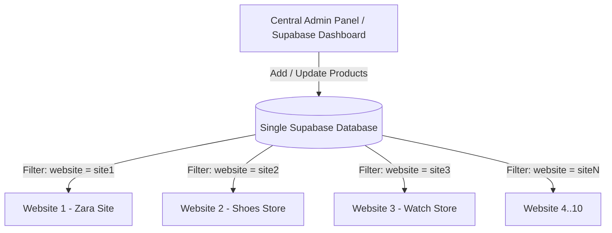

# 🚀 Multi-Store Single Admin Panel Guide (Fastest Architecture)

Yeh guide batati hai ke kaise **1 Supabase Project** aur **1 Centralized Admin Panel** se aap apni 10 alag-alag websites ke products ko easily manage kar sakte hain.

---

## 🏗️ Architecture Overview



* **1 Database:** Sabhi 10 websites ka data ek hi jagah hoga.
* **1 Admin Panel:** Ek jagah se product banayein aur choose karein ke yeh kis website par dikhe.
* **10 Frontends:** Har frontend sirf apne products fetch karega.

---

## ⚡ Step 1: Supabase Database Setup

Supabase dashboard mein ja kar **SQL Editor** open karein aur yeh table create karein:

```sql
-- 1. Create Products Table with 'websites' array column
create table products (
  id uuid default gen_random_uuid() primary key,
  title text not null,
  description text,
  price numeric not null,
  image text,
  category text,
  websites text[] default '{}', -- E.g. ARRAY['zara-site', 'perfume-site']
  created_at timestamp with time zone default timezone('utc'::text, now()) not null
);

-- 2. Enable Read Access for Public (Har website products parh sake)
alter table products enable row level security;

create policy "Allow public read access"
  on products for select
  using (true);
```

> **Tip:** `websites text[]` array column ka faida yeh hai ke 1 product ek hi waqt mein 1 se zyada websites par bhi show ho sakta hai (e.g. `['site1', 'site3']`).

---

## ⚙️ Step 2: Har Website (Frontend) Ka Setup

Sabhi websites par same Supabase project connect hoga, sirf **`VITE_WEBSITE_ID`** alag hoga.

### 1. Install Supabase Client (Har website par)
```bash
npm install @supabase/supabase-js
```

### 2. Environment Variables (`.env`)

#### Website 1:
```env
VITE_SUPABASE_URL=https://your-project.supabase.co
VITE_SUPABASE_ANON_KEY=your-anon-key-here
VITE_WEBSITE_ID=zara-site
```

#### Website 2:
```env
VITE_SUPABASE_URL=https://your-project.supabase.co
VITE_SUPABASE_ANON_KEY=your-anon-key-here
VITE_WEBSITE_ID=shoes-site
```

---

## 💻 Step 3: Frontend Code (Data Fetching)

### Supabase Client Setup (`src/lib/supabase.js`)
```javascript
import { createClient } from '@supabase/supabase-js';

const supabaseUrl = import.meta.env.VITE_SUPABASE_URL;
const supabaseAnonKey = import.meta.env.VITE_SUPABASE_ANON_KEY;

export const supabase = createClient(supabaseUrl, supabaseAnonKey);
```

### Products Fetch Helper (`src/services/productService.js`)
```javascript
import { supabase } from '../lib/supabase';

export async function getStoreProducts() {
  const currentSite = import.meta.env.VITE_WEBSITE_ID;

  // Supabase query jo check karegi ke 'websites' array mein current site shamil hai
  const { data, error } = await supabase
    .from('products')
    .select('*')
    .contains('websites', [currentSite]);

  if (error) {
    console.error('Error fetching products:', error);
    return [];
  }

  return data;
}
```

---

## 🎛️ Step 4: Admin Panel (Kahan Se Manage Hoga?)

Aapke paas **2 Raste** hain:

### Option A: Instant / Zero Coding (Supabase Dashboard)
* Supabase ke `Table Editor` mein direct jayein.
* "Insert Row" par click karein.
* `websites` column mein array daal dein: `["zara-site", "shoes-site"]`.
* Done! Website refresh karte hi product live ho jayega.

### Option B: Custom React Admin Dashboard
Ek simple dashboard banayein jisme product create karte waqt 10 websites ke checkboxes hon:

```jsx
// Admin Form Checkboxes Example
const SITES = [
  { id: 'zara-site', name: 'Zara Site' },
  { id: 'shoes-site', name: 'Shoes Store' },
  { id: 'watch-site', name: 'Watch Store' },
  // ... 10 sites
];

// Product save karne ka payload:
const newProduct = {
  title: "Casual Shirt",
  price: 49.99,
  image: "https://...",
  websites: ["zara-site", "shoes-site"] // Selected sites
};

await supabase.from('products').insert([newProduct]);
```

---

## 🔑 Key Benefits of This Approach

| Faida | Description |
| :--- | :--- |
| **No 10 Databases** | Sirf 1 Supabase project aur 1 free-tier par chal sakta hai. |
| **Unified Stock/Inventory** | Ek hi jagah se kisi product ki price ya picture update karein, jahan jahan wo linked hai sabhi jagah update ho jayegi. |
| **Fastest Setup** | Har website mein bas `.env` ka ID change karna hai, baaki pura codebase same reh sakta hai. |
